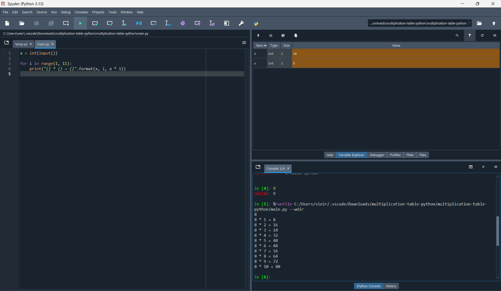

# Tabuada em Python

## Descrição

Este projeto consiste em um programa desenvolvido em Python que solicita ao usuário um número inteiro e exibe sua tabuada de multiplicação de 1 a 10.

## Pré-requisitos

- Python 3 instalado no computador.
- Nenhuma biblioteca externa é necessária.

Para baixar o Python, acesse: https://www.python.org/downloads/

## Como executar

1. Baixe ou clone este repositório.
2. Abra o terminal na pasta do projeto.
3. Execute o seguinte comando:

```bash
python main.py
```

Caso o comando não funcione, tente `python3 main.py` ou `py main.py`, dependendo do seu sistema operacional.

4. Digite um número inteiro e pressione Enter para visualizar a tabuada.

## Exemplo de entrada e saída

**Entrada:**

```text
7
```

**Saída:**

```text
7 * 1 = 7
7 * 2 = 14
7 * 3 = 21
7 * 4 = 28
7 * 5 = 35
7 * 6 = 42
7 * 7 = 49
7 * 8 = 56
7 * 9 = 63
7 * 10 = 70
```

## Demonstração

A imagem abaixo apresenta uma demonstração da execução do programa.



## Estrutura dos arquivos

```text
tabuada/
├── README.md
├── main.py
├── LICENSE
├── instructions.txt
├──imagens/demonstracao.png
└── multiplication-table-python.zip
```

## Licença

Este projeto utiliza a licença MIT. Para consultar o texto completo, acesse o arquivo [LICENSE](LICENSE).
